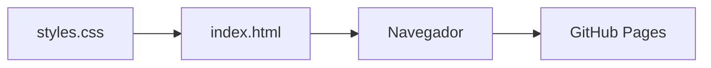

# Lab 01 - Control de Versiones con Git


Pagina web sencilla creada para practicar el flujo de trabajo con Git y GitHub: commits, historial y publicacion con GitHub Pages. Esta pensada para estudiantes que empiezan con control de versiones.

## Tabla de contenidos

- [Estado de las funciones](#estado-de-las-funciones)
- [Instalacion](#instalacion)
- [Uso](#uso)
- [Arquitectura](#arquitectura)
- [Hoja de ruta](#hoja-de-ruta)
- [Contribucion](#contribucion)
- [Autor](#autor)

## Estado de las funciones

| Funcion | Estado | Prioridad |
|:--------|:------:|----------:|
| Pagina principal (index.html) | Listo | Alta |
| Estilos (styles.css) | Listo | Media |
| Publicacion en GitHub Pages | Listo | Media |

## Instalacion

```bash
git clone https://github.com/estheridme/lab01-git.git
cd lab01-git
```

## Uso

Abre el archivo `index.html` en tu navegador. Esta es la estructura base de la pagina:

```html
<link rel="stylesheet" href="styles.css">
<h1>Lab 01 - Control de Versiones con Git</h1>
```

## Arquitectura



## Hoja de ruta

- [x] Crear repositorio y primer commit
- [x] Agregar .gitignore
- [x] Publicar con GitHub Pages
- [ ] Agregar mas secciones a la pagina
- [ ] Agregar licencia

## Contribucion

Lee la [guia de contribucion](CONTRIBUTING.md) antes de enviar cambios.

## Autor

Esther Idme Apaza - [@estheridme](https://github.com/estheridme)
